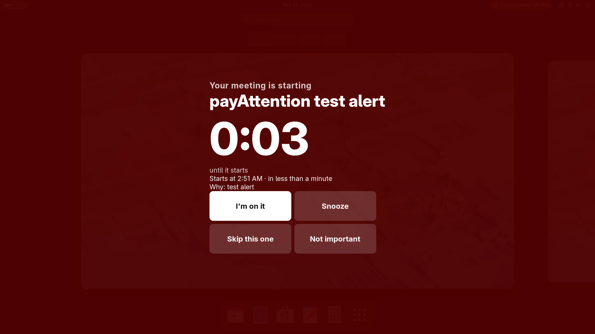

# payAttention

A GNOME Shell extension that stays quiet about the meetings that do not matter, and makes the ones that do impossible to miss.

- It reads the calendars already connected to your GNOME desktop (GNOME Online Accounts). There is no login and nothing to set up.
- It judges every meeting as **must-attend** or **ignorable**, and always shows the reason.
- Ignorable meetings make **no noise at all**.
- Must-attend meetings get alerts that escalate until you act: a heads-up, then a nudge, then an insist card, then a **full-screen takeover** on every monitor.
- In-person meetings count down to the time **you must leave**, not to the start time.
- Nothing leaves your machine. There is no AI service and no network call.



## Install

You need GNOME Shell 50 (Wayland or X11) and Node 24 for the build tools.

```sh
npm ci
npm run build
npm run install:local
```

Then **log out and log back in**. On Wayland, GNOME loads new extension code only at login. Check that it is running:

```sh
gnome-extensions info payattention@tonymalandain.github.io    # State: ACTIVE
```

The alarm icon in the top bar shows your next must-attend meeting and a countdown.

## Uninstall

```sh
npm run uninstall:local              # stop it, remove it, keep your saved choices
npm run uninstall:local -- --purge   # also erase overrides, travel times and settings
```

If payAttention is running, it stops at once, and no alert stays on screen. It no longer loads at login. The output lists what was removed and what was kept. Running it again is safe. It never touches your calendars or other extensions.

To reinstall after uninstalling, run `npm run install:local`, then log out and back in, because GNOME loads extension code only at login.

## First five minutes

1. Open the top-bar menu. Each of today's meetings shows its verdict: **Must attend** or ignorable.
2. Open a meeting's row to see **why** it got that verdict, for example "external guests" or "no other guests: personal block".
3. If a verdict is wrong, flip the **Must attend** switch. Use **Apply to whole series** so that every repeat of the meeting follows.
   - Personal tasks that matter but have no guests, such as picking up a child, are silent by default. Mark them once, for the whole series.
4. Click **Test alert**. It runs the whole ladder in about 30 seconds, so you can see each step without a real meeting.
5. For in-person meetings, set the travel time once in the meeting's row. It is remembered for that place.

## How it decides

The first rule that matches wins:

| Verdict | When |
|---|---|
| Your choice | You set it in the menu or on an alert |
| Ignorable | Cancelled, you declined, you are not invited, all-day, marked "free", or the title has an ignore word (hold, focus, lunch, block, OOO, …) |
| Must-attend | The title has an important word (interview, client, board, 1:1, …), you organised it with guests, or there are guests from outside your organisation |
| Ignorable | No other guests (a personal block), or more than 15 guests where nobody notices one person missing |
| Must-attend | 1 to 15 guests (ignorable if you answered "maybe") |
| Must-attend | Not enough information to judge. When unsure, it warns you. |

Meeting rooms are not counted as guests. The full rules are in [`docs/prd/meeting-guardian.md`](docs/prd/meeting-guardian.md).

## The alert ladder

| Step | Online (before start) | In person (before leave-by time) | What you see |
|---|---|---|---|
| Heads-up | 30 min | 10 min | A calm card at the top right. It goes away after 15 s. |
| Nudge | 10 min | 5 min | An amber card. It stays until you act. |
| Insist | 3 min | 2 min | A red card at the centre of the screen, pulsing, with a sound. |
| Takeover | 1 min, then every minute | at leave-by, then every minute | Full screen on every monitor. It goes away only when you choose an action. |

Actions: **Join** (opens the video link, online meetings only), **I'm on it**, **Snooze**, **Skip this one**, and **Not important** (for this meeting or the whole series). **I'm on it** or **Join** stops all alerts for that meeting. Alerts stop 10 minutes after the start. Alerts appear even in Do Not Disturb.

If the calendar has not updated for 15 minutes, the icon shows a warning. The menu names the calendar that is not updating, so you never mistake a broken calendar for a free afternoon.

All the timings, the default travel time (30 min), your extra important and ignore words, and the sound can be changed in **Settings** (from the menu).

## Limits, on purpose

- It only reads your calendar. It never changes it.
- It cannot tell that you joined a call some other way. Click **I'm on it**.
- Travel time is what you set per place, or the default. It does not use live traffic.
- Meetings booked on the web can take about 10 minutes to reach the desktop.
- Nothing shows over the lock screen.

## Documents

| What | Where |
|---|---|
| The problem, the solution, requirements, decisions | [`docs/product/`](docs/product/00-index.md) |
| The spec that was built | [`docs/prd/meeting-guardian.md`](docs/prd/meeting-guardian.md) |
| Architecture and ADRs | [`docs/architecture/`](docs/architecture/00-index.md) |
| Implementation plans | [`docs/plans/`](docs/plans/) |
| Delivery status | [`BACKLOG.md`](BACKLOG.md) |
| How long the build took | [`TIMELINE.md`](TIMELINE.md) |

## Development

Run the checks in this order: `npm run lint`, `npm test`, `npm run build`, `npm run test:helper`, `npm run smoke`. The smoke test checks install and uninstall in a throwaway home, then runs a hidden, headless GNOME Shell with its own test calendar. It never touches your session or your calendars. See [`docs/architecture/testing-and-build.md`](docs/architecture/testing-and-build.md).
