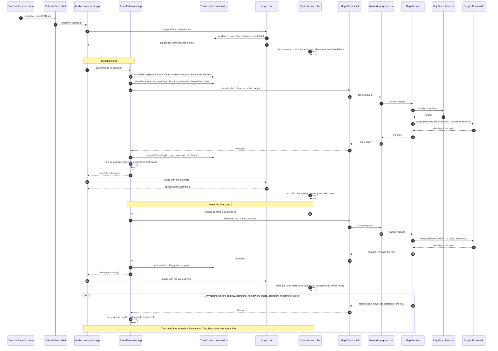

# PG-16 — The whole product after estimated travel time: resulting design

- **Status:** PROPOSED, awaiting the owner's approval. Not authoritative. This
  file draws the whole system as it would be **if** `proposal.md` (beside this
  file) were approved and built. Until the owner approves it, the accepted
  record (`overview.md`, `boundaries.md`, `interfaces.md`, `data.md`, the ADRs)
  stands unchanged, and no engineer may plan or build from this file.
- **Date:** 2026-10-04
- **Built from:** the code on `master` at `a5ce099` and the accepted
  architecture record for everything that exists today; `proposal.md`
  revision 3 (components A to J, tickets K1 to K5) for everything new.
- **Serves:** R-21 (estimated travel time), R-11 (travel time), R-3 (what
  leaves the machine). Shows where PG-17 (start from the meeting before, D-044)
  and PG-18 (buffer, D-045) plug in.
- **Names:** "ai/ or net/" — the proposal renames the AI helper's directory to
  `net/` only if the owner agrees. This file writes `net/`; read `ai/` if the
  rename is declined. The design is the same either way.

## 1. The shape in one paragraph

payAttention stays one GNOME Shell extension around a GNOME-free core
(ADR-0011, D-049). Rules live in `core/`, orchestration in `app/`, and every
GNOME part is an adapter behind a named port. Four programs of ours run as
separate processes from the desktop's own: the **calendar helper** (reads
calendars, read-only), the **network program** (today's AI helper, which now
also asks Google for travel times), the **Settings window**, and the
**terminal preview**. PG-16 adds pure rule modules (travel, route,
the key-store port, the Settings window's travel decisions), one orchestration
part (`TravelEstimates`), one adapter (`MapsClient`), one network service
(`MapsService`) and one shared password store adapter (`keystore/`), and
changes the existing parts marked in section 4. It adds no new process and no
new stored data other than three settings and the Google key.

## 2. Component diagram

How to read it:

- **Boxes inside a process** run in that process. `core/` and `keystore/` are
  drawn apart because the same code is loaded into several processes.
- **Solid arrow** `A --> B`: A depends on B (imports it, calls it, or reads
  it). Arrows point inward: adapters to ports, `app/` to `core/`.
- **Dotted arrow labelled "implements"**: an adapter fills a port.
- **Thick arrow**: one process starts another and talks to it as one JSON
  message per line on standard input and output.
- **Colours**: grey = exists and unchanged; amber = exists and changed by
  PG-16; green = new in PG-16; blue hexagon = a port (green-filled if new);
  dashed white = outside system; purple dotted = where PG-17 and PG-18 attach.

```mermaid
flowchart TB
    subgraph LEGEND["Legend"]
        direction LR
        LG_E["exists, unchanged"]:::existing
        LG_C["exists, changed by PG-16"]:::changed
        LG_N["new in PG-16"]:::new
        LG_P{{"port"}}:::port
        LG_NP{{"new port"}}:::newport
        LG_X[("outside system")]:::external
        LG_F["PG-17 / PG-18 attach here"]:::future
    end

    subgraph SHELLPROC["gnome-shell process: the extension, front end 1"]
        direction TB
        subgraph S_FRONT["Front end: composition root"]
            EXT["extension.js<br/>builds every part in enable, destroys it in disable<br/>+ wires the route-estimate port"]:::changed
        end
        subgraph S_UI["UI: ui/, GNOME actors, decides nothing"]
            UI["Ui: indicator and menu, card, takeover, alert sound<br/>ui/ui.js, indicator.js, meetingRow.js,<br/>card.js, takeover.js, alertContent.js, takeoverSize.js"]:::existing
        end
        subgraph S_APP["app/: GNOME-free orchestration, Node-tested"]
            CTRL["Controller<br/>app/controller.js<br/>1 s tick, plan, actions, alert state<br/>+ tells TravelEstimates at each heads-up"]:::changed
            VERD["Verdict component<br/>app/verdicts.js<br/>the only judge caller<br/>+ passes the estimates into judge"]:::changed
            AIQ["AI queue and budget<br/>app/aiQueue.js, aiBudget.js"]:::existing
            TRE["TravelEstimates<br/>app/travelEstimates.js<br/>when to ask, held in memory only,<br/>daily cap, estimate health"]:::new
            VIEW["View<br/>app/view.js<br/>+ estimated / default mark,<br/>+ estimate status line"]:::changed
            HEALTH["Health, backoff, sound cue<br/>app/health.js, backoff.js, soundCue.js"]:::existing
        end
        subgraph S_PORTS["Ports: interfaces app/ owns, filled by adapters"]
            P_FEED{{"FeedPort"}}:::port
            P_SR{{"StoreReaderPort"}}:::port
            P_SW{{"StoreWriterPort"}}:::port
            P_AI{{"AiClientPort"}}:::port
            P_ROUTE{{"RouteEstimatePort<br/>estimate from, to, departAt, kind"}}:::newport
            P_TICK{{"Ticker"}}:::port
            P_ENV{{"EnvironmentPort"}}:::port
            P_UI{{"UiPort"}}:::port
            P_LAUNCH{{"launchUri"}}:::port
            P_CLOCK{{"Clock: now"}}:::port
        end
        subgraph S_ADP["GNOME adapters: shell/"]
            FEED["CalendarFeed<br/>shell/calendarFeed.js, helperProcess.js"]:::existing
            STORE["StoreReader and StoreWriter<br/>shell/store.js, settingsKeys.js<br/>+ estimate switch, Home, Work"]:::changed
            NETC["Network program client<br/>shell/aiHelperClient.js, netClient.js if renamed<br/>one process serves both ports,<br/>runs while either is needed"]:::changed
            MAPSC["MapsClient<br/>shell/mapsClient.js<br/>thin facade over the shared process"]:::new
            TICK["Ticker<br/>shell/ticker.js"]:::existing
            ENV["Environment: idle, resume<br/>shell/environment.js"]:::existing
            LAUNCH["Link launcher<br/>shell/launcher.js"]:::existing
        end
    end

    subgraph HELPERPROC["calendar helper process: gjs, read-only, GNOME adapter for the calendar source"]
        H_HOST["Helper host<br/>helper/main.js, stdio.js, messages.js, summary.js"]:::existing
        H_READ["EDS reader<br/>helper/calendarReader.js, transcribe.js,<br/>snapshotService.js, range.js, text.js, connection.js"]:::existing
    end

    subgraph NETPROC["network program process: gjs, today the AI helper; runs when AI mode or estimates are on"]
        subgraph N_GNOME["GNOME part: host and transport"]
            N_HOST["Host<br/>net/main.js, net/stdio.js<br/>reads requests, routes each to its service"]:::changed
            N_HTTP["HttpTransport<br/>net/transport.js, Soup 3<br/>transport rule by endpoint class"]:::existing
        end
        subgraph N_PORTS["Ports injected into the services"]
            P_TRANSPORT{{"Transport: post"}}:::port
        end
        subgraph N_LOGIC["Logic: net/services/, lint-enforced GNOME-free"]
            N_AI["AiService and chat<br/>net/services/aiService.js, chat.js<br/>moved from ai/, behaviour unchanged"]:::changed
            N_MAPS["MapsService<br/>net/services/mapsService.js<br/>key, request, reply, failure code"]:::new
        end
    end

    subgraph PREFSPROC["Settings window process: GTK4 and libadwaita"]
        PREFS["Settings window<br/>prefs.js<br/>+ Travel section: Home, Work, switch,<br/>Google key, Test connection, privacy warning<br/>+ asks for the AI key again"]:::changed
    end

    subgraph PREVPROC["terminal preview process: gjs, front end 2, read-only"]
        PV_MAIN["Preview composition<br/>preview/main.js"]:::existing
        PV_LOGIC["Preview logic<br/>preview/session.js, report.js, cli.js"]:::existing
    end

    subgraph UNINST["uninstall script"]
        UN["scripts/uninstall.sh --purge<br/>+ clears the new Key schema and the old EngineKey"]:::changed
    end

    subgraph KSDIR["keystore/: the one password store adapter, loaded by the network program and the Settings window"]
        KS_LIB["LibsecretKeyStore<br/>keystore/libsecretKeyStore.js<br/>the only gi://Secret import<br/>replaces ai/keyring.js and the copy in prefs.js"]:::new
    end

    subgraph CORE["core/: pure rules, GNOME-free; loaded by every process that imports it"]
        C_JUDGE["Verdict rules<br/>judge.js, verdict.js, words.js, owner.js,<br/>attendance.js, links.js, keys.js, invite.js, fingerprint.js<br/>+ judge takes estimates, records the travel source"]:::changed
        C_PLAN["Alert ladder<br/>plan.js, alertState.js, timing.js, testAlert.js"]:::existing
        C_TRAVEL["Travel rules<br/>core/travel.js<br/>own, else estimate, else default<br/>start place: Work weekdays, Home weekends<br/>rough = slow end + 30 min, live = as given"]:::new
        C_ROUTES["Route rules<br/>core/routes.js<br/>Google request body and reply reader"]:::new
        C_KS{{"KeyStore port<br/>core/keyStore.js<br/>lookup, store, clear by purpose and scope"}}:::newport
        C_PROTO["Protocols<br/>protocol.js: calendar snapshot<br/>aiProtocol.js: shell to network program<br/>+ route request and reply messages"]:::changed
        C_AI["AI rules<br/>aiEngine.js, aiPrompt.js, aiAnswers.js, aiSetup.js"]:::existing
        C_TSET["Travel settings decisions<br/>module name not fixed by the proposal"]:::new
        C_DISP["Formatting, defaults, types<br/>display.js, defaults.js, types.js<br/>+ defaults of the new settings"]:::changed
    end

    subgraph EXTSYS["Outside systems"]
        X_EDS[("evolution-data-server<br/>fed by GNOME Online Accounts")]:::external
        X_DCONF[("GSettings and dconf")]:::external
        X_SECRET[("GNOME password store<br/>Secret Service, gnome-keyring")]:::external
        X_GOOGLE[("Google Routes API<br/>computeRoutes over HTTPS")]:::external
        X_AIENG[("AI engine<br/>OpenAI-compatible, local or cloud")]:::external
        X_GNOME[("GNOME Shell and session<br/>St, Clutter, Main, idle monitor,<br/>login manager, sound theme")]:::external
        X_APPS[("Browser or meeting app<br/>via Gio.AppInfo")]:::external
    end

    PG17["PG-17 start from the meeting before<br/>one more start-place rule, one more re-ask trigger"]:::future
    PG18["PG-18 buffer<br/>one setting, added after the ranking,<br/>shown as + 10 min buffer"]:::future

    %% composition root
    EXT --> CTRL
    EXT --> UI
    EXT --> FEED
    EXT --> STORE
    EXT --> NETC
    EXT --> MAPSC
    EXT --> TICK
    EXT --> ENV
    EXT --> LAUNCH
    EXT -. "implements with Date.now" .-> P_CLOCK

    %% app ring
    CTRL --> VERD
    CTRL -->|"heads-up fired, health"| TRE
    CTRL --> VIEW
    CTRL --> HEALTH
    CTRL --> C_PLAN
    CTRL --> P_SW
    CTRL --> P_ENV
    CTRL --> P_UI
    CTRL --> P_TICK
    CTRL --> P_LAUNCH
    VERD --> AIQ
    VERD -->|"estimates by occurrence"| TRE
    VERD --> C_JUDGE
    VERD --> P_FEED
    VERD --> P_SR
    VERD --> P_CLOCK
    AIQ --> P_AI
    AIQ --> C_AI
    TRE --> C_TRAVEL
    TRE --> P_ROUTE
    TRE -->|"switch, Home, Work"| P_SR
    TRE --> P_CLOCK
    VIEW --> C_DISP
    C_JUDGE --> C_TRAVEL

    %% adapters fill ports
    FEED -. implements .-> P_FEED
    STORE -. implements .-> P_SR
    STORE -. implements .-> P_SW
    NETC -. implements .-> P_AI
    MAPSC -. implements .-> P_ROUTE
    TICK -. implements .-> P_TICK
    ENV -. implements .-> P_ENV
    UI -. implements .-> P_UI
    LAUNCH -. implements .-> P_LAUNCH
    MAPSC -->|"shares the process"| NETC
    FEED --> C_PROTO
    FEED --> HEALTH
    NETC --> C_PROTO
    NETC --> HEALTH
    UI --> C_DISP

    %% processes
    FEED ==>|"spawns, NDJSON stdio"| H_HOST
    NETC ==>|"spawns, NDJSON stdio"| N_HOST
    PREFS ==>|"spawns once for Test connection"| N_HOST

    %% calendar helper
    H_HOST --> H_READ
    H_HOST --> C_PROTO

    %% network program
    N_HOST --> N_AI
    N_HOST --> N_MAPS
    N_HOST --> N_HTTP
    N_HOST --> KS_LIB
    N_HOST --> C_PROTO
    N_HTTP -. implements .-> P_TRANSPORT
    KS_LIB -. implements .-> C_KS
    N_AI --> P_TRANSPORT
    N_AI --> C_KS
    N_AI --> C_AI
    N_MAPS --> P_TRANSPORT
    N_MAPS --> C_KS
    N_MAPS --> C_ROUTES

    %% Settings window, preview, uninstall
    PREFS -->|"write and clear keys"| KS_LIB
    PREFS --> C_AI
    PREFS --> C_TSET
    PREFS --> C_DISP
    PV_MAIN --> PV_LOGIC
    PV_LOGIC --> VERD
    PV_MAIN -. "own instances of" .-> FEED
    PV_MAIN -. "own instances of" .-> STORE
    PV_MAIN -. "own instances of" .-> NETC
    PV_MAIN -. "own instances of" .-> TICK

    %% outside systems
    H_READ --> X_EDS
    STORE --> X_DCONF
    PREFS --> X_DCONF
    KS_LIB --> X_SECRET
    N_HTTP -->|"maps key, addresses, departure time"| X_GOOGLE
    N_HTTP -->|"bounded invite"| X_AIENG
    UI --> X_GNOME
    ENV --> X_GNOME
    LAUNCH --> X_APPS
    UN --> X_DCONF
    UN --> X_SECRET

    %% where the next two tickets attach
    PG17 -.-> C_TRAVEL
    PG17 -.-> TRE
    PG18 -.-> C_TRAVEL
    PG18 -.-> STORE
    PG18 -.-> PREFS
    PG18 -.-> VIEW

    classDef existing fill:#f2f2f2,stroke:#888888,color:#222222
    classDef changed fill:#fff1c2,stroke:#b8860b,stroke-width:2px,color:#222222
    classDef new fill:#d4f7d4,stroke:#2e7d32,stroke-width:3px,color:#222222
    classDef port fill:#e3ecff,stroke:#3559b5,color:#222222
    classDef newport fill:#d4f7d4,stroke:#3559b5,stroke-width:3px,color:#222222
    classDef external fill:#ffffff,stroke:#555555,stroke-dasharray:4 3,color:#222222
    classDef future fill:#f3e5ff,stroke:#7b3fb5,stroke-dasharray:2 2,color:#222222
```



**Not drawn, to keep the picture readable:** `core/` imports inside `core/`
(for example `judge.js` reading `invite.js`), the Settings window's other
`core/` imports (`words.js`, `protocol.js`), and the shell process's direct
use of GLib. All of them are unchanged by PG-16 and listed in
`boundaries.md`.

**Removed by PG-16:** `ai/keyring.js` (replaced by `keystore/libsecretKeyStore.js`)
and the libsecret schema built inside `prefs.js`. Repays the key-store leak
recorded in ADR-0011 (Leak 4).

## 3. The estimate flow

One in-person meeting with a place and no travel time of the owner's own.
"Rough" is asked when the meeting is first seen; "live" is asked when its
heads-up fires (D-047). Nothing in this flow ever makes an alert wait: until
an answer arrives, the default travel time applies.



**What the failure path keeps.** The proposal says a failure "leaves the
default in place". For a failed *live* ask after a good *rough* one it does
not say whether the rough estimate stays or the default returns; the diagram
writes "the travel time already in force stays", which is the reading I would
recommend, but it is not decided (section 7).

**After a restart, a log-out or a screen lock** (locking disables the
extension, ADR-0005), memory is empty: every eligible meeting from 1 hour back
to 36 hours ahead is asked again, rough before its heads-up and live after it,
under the daily cap.

## 4. Every component

Layer names: **core** = pure rules; **app** = GNOME-free orchestration;
**adapter** = GNOME part behind a port; **front end** = a composition root or
a window; **logic** = GNOME-free code inside a subprocess. Status: existing,
**changed**, **NEW**. Letters A to J are the proposal's component names.

| Component | Layer | Process | Responsible for | Depends on | Used by | Main modules | Status |
|---|---|---|---|---|---|---|---|
| Composition root | front end | gnome-shell | Building every part in `enable()`, destroying all of it in `disable()`; reading the developer marker. No logic. | Controller, every `shell/` adapter, Ui | GNOME Shell | `extension.js` | **changed**: wires the route-estimate port (MapsClient) beside the AI client |
| UI | adapter (UI sink) | gnome-shell | Drawing the view: indicator and menu, card, takeover with its modal grab, alert sound. Emits the owner's actions. Decides nothing (ADR-0004). | GNOME Shell (St, Clutter, Main), `core/display.js` | Controller, through `UiPort` | `ui/ui.js`, `indicator.js`, `meetingRow.js`, `card.js`, `takeover.js`, `alertContent.js`, `takeoverSize.js` | existing: draws the new text it is given |
| Controller | app | gnome-shell | The 1-second tick, `plan`, alert state through `reduce`, the owner's actions, sound edges, the test alert, calendar health, every part's lifetime. | Verdict component, View, health, sound cue, `core/plan.js`, `core/alertState.js`, writer, environment, UI, ticker, launcher ports; TravelEstimates | Composition root | `app/controller.js` | **changed**: tells TravelEstimates when a heads-up fires; reads estimate health for the view |
| Verdict component | app | gnome-shell, preview | Everything between the inputs and the judged list; the only caller of `judge`, re-running it only when an input moved (ADR-0011). | Store reader, calendar feed, AI queue, TravelEstimates, `core/judge.js`, clock | Controller, preview | `app/verdicts.js` | **changed**: passes the estimates into `judge` and re-judges when they change |
| AI queue and budget | app | gnome-shell, preview | Which meeting to ask the AI next, when, what each outcome means; the request budget (§6.5). | AI client port, `core/aiAnswers.js` | Verdict component | `app/aiQueue.js`, `app/aiBudget.js` | existing |
| G. TravelEstimates | app | gnome-shell | When an estimate is due (meeting found; its heads-up; place, start time or start place changed), asking through the route-estimate port, holding answers in memory only, the daily call cap, estimate health (off, no key, bad key, no network, no Home or Work). Never makes an alert wait. | Travel rules, route-estimate port, store reader (switch, Home, Work), clock | Verdict component (estimates), Controller (heads-up, health) | `app/travelEstimates.js` | **NEW** |
| H. View | app | gnome-shell | What the owner reads: "Travel: 25 min (estimated)", "(default)", nothing for the owner's own time; the one status line when estimates are not working, beside "AI unavailable — using rules". | `core/display.js`, the travel source on each judged occurrence, estimate health | Controller, then UI | `app/view.js` | **changed** |
| Health, backoff, sound cue | app | gnome-shell | Calendar data health and its clocks; restart delays for subprocesses; when a step plays a sound. | nothing outside `app/` | Controller, CalendarFeed, network program client | `app/health.js`, `app/backoff.js`, `app/soundCue.js` | existing |
| Calendar feed | adapter (calendar source) | gnome-shell, preview | Spawning and supervising the calendar helper, validating each snapshot, keeping the last good one and its freshness, refreshing on resume. Never filters or edits events. | Calendar helper (process), `core/protocol.js`, `app/health.js`, `app/backoff.js`, `shell/helperProcess.js` | Verdict component, through `FeedPort` | `shell/calendarFeed.js`, `shell/helperProcess.js` | existing |
| I. Settings store | adapter (store reader and writer) | gnome-shell, preview (reader only) | Typed read and write of every GSettings key; reader and writer facets; coalescing and pruning (ADR-0003). Knows no rules. | GSettings and dconf, `core/alertState.js`, `core/aiAnswers.js`, `core/keys.js` | Verdict component, TravelEstimates (reader); Controller (writer) | `shell/store.js`, `shell/settingsKeys.js`, `schemas/…gschema.xml` | **changed**: three new settings — estimate switch (off by default), Home, Work. PG-18 adds Buffer |
| E. Network program client | adapter (AI engine port and route-estimate port) | gnome-shell, preview | Spawning the network program, restarting it with backoff, matching replies to requests. One process serves both ports; started when either is needed, stopped when neither is. | Network program (process), `core/aiProtocol.js` with route messages, `app/backoff.js`, `shell/helperProcess.js` | AI queue (AI port), MapsClient, composition roots | `shell/aiHelperClient.js` (`shell/netClient.js` if renamed) | **changed** |
| E. MapsClient | adapter (route-estimate port) | gnome-shell | Implementing `estimate(from, to, departAt, kind)` returning minutes or a failure, as a thin facade over the shared process. | Network program client | TravelEstimates | `shell/mapsClient.js` | **NEW** |
| Ticker, environment, link launcher | adapters | gnome-shell (ticker also preview) | The 1 s timer; idle and resume signals; opening a join link in the right app. | GLib, GNOME Shell idle monitor and login manager, Gio.AppInfo | Controller, AI queue | `shell/ticker.js`, `shell/environment.js`, `shell/launcher.js` | existing |
| Calendar helper | adapter (calendar source), own process | calendar helper | The only code that touches evolution-data-server: lists calendars, expands occurrences for the window, writes a faithful, judgment-free snapshot. Read-only; never logs content (ADR-0001). | EDS (ECal, EDataServer, ICalGLib), `core/protocol.js` | Calendar feed (spawns it) | `helper/main.js`, `stdio.js`, `messages.js`, `summary.js`, `calendarReader.js`, `transcribe.js`, `snapshotService.js`, `range.js`, `text.js`, `connection.js` | existing: PG-16 does not touch it (`proposal.md` §7) |
| B. Network program host | adapter host, own process | network program | Being the one program that talks to the network and reads keys: start, read requests, route each to its service, write replies, end on EOF. Owns the HTTP transport and its rule by endpoint class. | LibsecretKeyStore, the services, `core/aiProtocol.js`, Soup, Gio, GioUnix, GLib, `system` | Network program client (spawns it), Settings window (Test connection) | `net/main.js`, `net/stdio.js`, `net/transport.js` (today `ai/`) | **changed**: second service; runs when AI mode **or** estimates are on |
| C. Network services | logic, in a subprocess | network program | Turning one validated request into one outgoing HTTP request, and one reply into a validated answer or a short failure code. AI: as today. Maps: key through the KeyStore port, body and reply through route rules; failure codes no-key, bad-key, not-found, network, quota, bad-reply. Never logs addresses or keys. | Route rules, AI rules, KeyStore port, transport port (both injected) | Network program host | `net/services/aiService.js`, `chat.js` (moved from `ai/`), `net/services/mapsService.js` | **changed** (AI, moved) and **NEW** (Maps) |
| A. KeyStore port | core | every process that imports it | Saving, reading and clearing a secret for one purpose, never prompting: `lookup` gives found, absent or unavailable; `store`; `clear`. Purposes "ai-engine" (scoped by normalised endpoint) and "maps" (scope "google"); schema and attribute names. | nothing | AI and Maps services, LibsecretKeyStore, MemoryKeyStore | `core/keyStore.js` | **NEW** |
| A. LibsecretKeyStore | adapter (key store) | network program, Settings window | The only code that imports `gi://Secret`. One schema `org.gnome.shell.extensions.payattention.Key` with attributes purpose and scope. The old EngineKey schema is no longer read; the AI key is typed again (D-046). | GNOME password store, Gio, GLib, KeyStore port | Network program host (read), Settings window (write, clear) | `keystore/libsecretKeyStore.js` | **NEW**, replaces `ai/keyring.js` |
| D. Route rules | core | network program, gnome-shell | Google's wire format and nothing else: endpoint, field mask, request body (rough: PESSIMISTIC with a departure time; live: BEST_GUESS, leave now), reply validator, address length bounds. | nothing outside `core/` | MapsService; tests | `core/routes.js` | **NEW** |
| Protocols | core | all three of ours that speak NDJSON | Calendar snapshot protocol (§1); shell to network program protocol (§6.6). Validation of every line both ways. | other `core/` | Calendar feed, calendar helper, network program client, network program host | `core/protocol.js`, `core/aiProtocol.js` (or a sibling `core/netProtocol.js` if renamed) | **changed**: route request and reply messages |
| F. Travel rules | core | gnome-shell, preview | Which travel time applies and its source: own (place or series, ADR-0014), else estimate, else default (D-042). Start place (D-043). Eligibility. Rough = slow end + 30 min (D-048); live = as given. | nothing outside `core/` | TravelEstimates, `judge` | `core/travel.js` | **NEW** |
| Verdict rules | core | gnome-shell, preview | `judge`: occurrence to verdict and reason, mode, join link, travel time and its target, deadline; with the word lists, owner facts, attendance, links, keys, invite and fingerprint. | other `core/` | Verdict component only | `core/judge.js`, `verdict.js`, `words.js`, `owner.js`, `attendance.js`, `links.js`, `keys.js`, `invite.js`, `fingerprint.js` | **changed**: `judge` takes estimates by occurrence key and records the source ("own", "estimated", "default") |
| Alert ladder | core | gnome-shell | `plan`: now, judged list, alert state, timing to what is on screen; `reduce`; timing; the test alert. | other `core/` | Controller | `core/plan.js`, `alertState.js`, `timing.js`, `testAlert.js` | existing: the deadline already follows the judged travel time |
| AI rules | core | gnome-shell, network program, Settings window | Endpoint rules, prompt, reply validator, stored answers, every Settings decision for AI. | other `core/` | AI queue, AI service, Settings window | `core/aiEngine.js`, `aiPrompt.js`, `aiAnswers.js`, `aiSetup.js` | existing (the key schema constants move to `core/keyStore.js`; see section 7) |
| Travel settings decisions | core | Settings window | The Settings window's travel decisions, so `prefs.js` holds none ("a travel counterpart" of `aiSetup.js`). | other `core/` | Settings window | name not fixed by the proposal | **NEW** |
| Formatting, defaults, types | core | all | Text formatting, the default of every setting, shared type definitions. | nothing | View, UI, Settings window, settings keys | `core/display.js`, `defaults.js`, `types.js` | **changed**: defaults and types of the new settings |
| J. Settings window | front end | Settings window | Every setting the owner edits. New: the Travel section (Home, Work, the switch, the Google key field, Test connection, privacy warning); asking for the AI key again (D-046). Holds no decisions. | LibsecretKeyStore (write, clear), GSettings, network program (spawned for the test), `core/` | the owner | `prefs.js` | **changed** |
| Verdict preview | front end | terminal preview | A read-only terminal report of how every meeting is judged (ADR-0012). Never alerts or writes. | Verdict component, its own calendar feed, store reader, network program client, ticker | the owner, from a terminal | `preview/main.js`, `session.js`, `report.js`, `cli.js` | existing: whether it asks for estimates is open (section 7) |
| Uninstall script | script | uninstall | Removing the extension; with `--purge`, erasing its settings and its keyring items, nothing else. | dconf, GNOME password store | the owner | `scripts/uninstall.sh` | **changed**: clears the new Key schema as well as EngineKey |
| Build | script | build | Packing exactly `extension/` into the zip, normal and developer bundles. | `gnome-extensions pack` | the owner, CI | `scripts/build.sh` | **changed**: the new directories (`keystore/`, `net/` if renamed) passed with `--extra-source` |

## 5. Folder tree after PG-16

Markers: `NEW`, `CHANGED`, `MOVED` (from `ai/` if the rename is taken),
`REMOVED`. Unmarked files exist today and do not change. Test file names
marked `(name illustrative)` are the senior engineer's to choose; the proposal
names only `memoryKeyStore.js`.

```
extension/
  metadata.json
  extension.js                     CHANGED  wires the route-estimate port
  prefs.js                         CHANGED  Travel section; no Secret schema of its own
  stylesheet.css
  schemas/
    org.gnome.shell.extensions.payattention.gschema.xml   CHANGED  switch, Home, Work
  core/                            pure rules
    keyStore.js                    NEW      KeyStore port, purposes, schema constants
    routes.js                      NEW      Google request and reply rules
    travel.js                      NEW      ranking, start place, rough and live arithmetic
    <travel settings decisions>    NEW      name not fixed by the proposal
    judge.js                       CHANGED  estimates input, travel source
    aiProtocol.js                  CHANGED  route messages (or a sibling netProtocol.js)
    aiEngine.js                    CHANGED? key schema constants move to keyStore.js
    defaults.js, types.js          CHANGED  new settings
    aiAnswers.js, aiPrompt.js, aiSetup.js, alertState.js, attendance.js,
    display.js, fingerprint.js, invite.js, keys.js, links.js, owner.js,
    plan.js, protocol.js, testAlert.js, timing.js, verdict.js, words.js
  app/                             GNOME-free orchestration
    travelEstimates.js             NEW      TravelEstimates
    controller.js                  CHANGED  heads-up hook, estimate health
    verdicts.js                    CHANGED  estimates into judge
    view.js                        CHANGED  estimated / default mark, status line
    aiBudget.js, aiQueue.js, backoff.js, health.js, soundCue.js
  shell/                           GNOME adapters, in the desktop's process
    mapsClient.js                  NEW      route-estimate port adapter
    aiHelperClient.js              CHANGED  serves both ports (netClient.js if renamed)
    store.js, settingsKeys.js      CHANGED  new settings
    calendarFeed.js, environment.js, helperProcess.js, launcher.js, ticker.js
  ui/
    alertContent.js, card.js, indicator.js, meetingRow.js, takeover.js,
    takeoverSize.js, ui.js
  helper/                          calendar helper process, unchanged
    calendarReader.js, connection.js, main.js, messages.js, range.js,
    snapshotService.js, stdio.js, summary.js, text.js, transcribe.js
  net/                             MOVED from ai/ (rename optional, owner to decide)
    main.js                        CHANGED  routes requests to two services
    stdio.js                       MOVED
    transport.js                   MOVED
    services/                      NEW      lint-enforced GNOME-free
      aiService.js                 MOVED    from ai/service.js
      chat.js                      MOVED    from ai/chat.js
      mapsService.js               NEW      MapsService
  ai/keyring.js                    REMOVED  replaced by keystore/libsecretKeyStore.js
  keystore/                        NEW      the only gi://Secret code
    libsecretKeyStore.js           NEW      imported by net/main.js and prefs.js only
  preview/
    cli.js, main.js, report.js, session.js

scripts/
  build.sh                         CHANGED  packs keystore/ (and net/)
  uninstall.sh                     CHANGED  --purge clears the Key and EngineKey schemas
  extension-state.sh, install.sh, isolated-shell.sh, sample.sh, smoke.sh

tests/
  unit/
    support/memoryKeyStore.js      NEW      in-memory KeyStore for Node tests
    travel.test.js                 NEW      (name illustrative)
    routes.test.js                 NEW      (name illustrative)
    travelEstimates.test.js        NEW      (name illustrative)
    boundaries.test.js             CHANGED  new import rules
    judge.*.test.js, view.test.js, controller.test.js, schema.test.js   CHANGED
    … every other existing unit suite
  ai/  (tests/net/ if renamed)
    mapsService.test.js            NEW      (name illustrative) against a fake Google on 127.0.0.1
    keyring.test.js, gjs/keyring.js  CHANGED  now test keystore/
    … every other existing AI helper suite
  helper/                          unchanged
  smoke/
    uninstall-check.sh             CHANGED  seeds and checks both schemas
    … unchanged otherwise
eslint.config.js                   CHANGED  keystore/ and net/services/ rules
```

**Import rules that change** (from `proposal.md` §4, to be written into
`boundaries.md` only after approval): only `keystore/` may import
`gi://Secret`; only `net/main.js` and `prefs.js` may import `keystore/`;
`net/services/` may import neither `gi://`, `resource://`, `system` nor Node
built-ins; `prefs.js` loses its own `gi://Secret` import.

## 6. Outside systems

| System | Reached by | Through | What crosses | Direction |
|---|---|---|---|---|
| evolution-data-server, fed by GNOME Online Accounts | calendar helper only | ECal, EDataServer, ICalGLib over D-Bus | calendars and occurrences in; nothing out (read-only) | read |
| GSettings and dconf | store (shell process), Settings window, preview (reader, delay-apply), uninstall `--purge` | Gio.Settings, `dconf reset` | settings, overrides, travel times, alert state, AI answers, health clocks; **plus** the estimate switch, Home, Work. Estimates themselves never | read and write |
| GNOME password store (Secret Service, gnome-keyring) | LibsecretKeyStore only (network program reads, Settings window writes and clears), uninstall `--purge` | libsecret | the AI engine key and the Google key, one schema with purpose and scope | read and write |
| Google Routes API (`routes.googleapis.com`, `computeRoutes`) | MapsService through HttpTransport, in the network program only | HTTPS POST, field mask `routes.duration` | start address, place text, departure time, the key in a header. Never titles, descriptions or guests (D-041) | out and back |
| AI engine, OpenAI-compatible, local or cloud | AiService through HttpTransport, in the network program only, AI mode only | HTTP for loopback, HTTPS otherwise | the bounded invite (D-020) and the key when one is set | out and back |
| GNOME Shell and the session | UI, environment, ticker, composition root | St, Clutter, Main, idle monitor, login manager, sound theme | drawing, modal grab, idle and resume signals | in-process |
| Browser or meeting app | link launcher | Gio.AppInfo with the Shell launch context | one allowlisted https join link | out |

## 7. What this file had to assume, and what stays open

None of these changes the drawing much; each is a point the proposal leaves
open or does not state.

1. **Who builds TravelEstimates.** The proposal says it is used by the verdict
   component and by the controller. The drawing shows both edges. Whether the
   verdict component owns it (as it owns the AI queue) or the controller owns
   it and hands its estimates in is not stated. It matters for the preview.
2. **The preview and estimates.** If the verdict component owns
   TravelEstimates, the preview (which builds its own verdict component) would
   either ask Google too — costing money from a read-only tool — or need a
   "no estimates" port. The proposal does not say. The drawing leaves the
   preview unchanged.
3. **A failed live ask.** Whether the rough estimate stays or the default
   returns (section 3).
4. **The live ask's timing.** D-047 says "at the heads-up"; the product
   manager's open question to the owner is "15 minutes before it". The flow
   draws D-047 as recorded.
5. **The rename.** `net/` versus `ai/`, and so `netClient.js` and
   `netProtocol.js`, are the owner's call.
6. **The AI key lookup.** Today the host passes a `lookupKey` function into
   `AiService` (`extension/ai/main.js:41-48`). The drawing shows both services
   reaching the KeyStore port, which is how the proposal describes Maps; it
   does not say whether the AI service's injection changes shape the same way.
7. **`core/aiEngine.js`.** It defines the EngineKey schema name today
   (`boundaries.md`, "Known duplicate"). The proposal moves schema constants
   to `core/keyStore.js` but `--purge` still has to clear the old schema; where
   that old name lives afterwards is not stated.
8. **The travel settings decisions module** has no name in the proposal.
