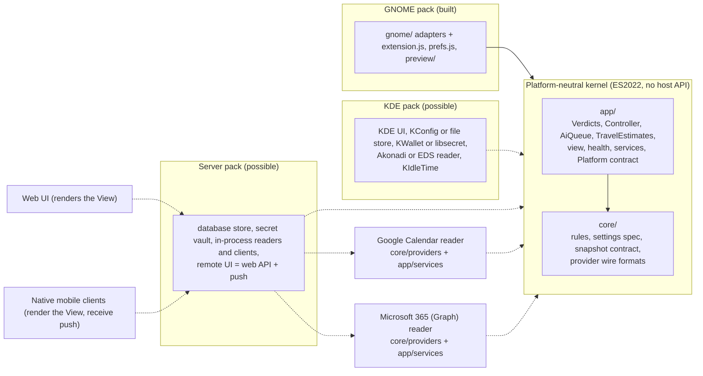

# PG-20 — The system after migration: resulting design

- **Status:** proposed — awaiting owner approval. Not authoritative. This file
  draws the whole system as it would be **if** `proposal.md` option A were
  approved and `migration.md` built. Until then the accepted record stands
  unchanged, and no engineer may plan or build from this file.
- **Date:** 2026-10-10
- **Built from:** the code on `master` at `edbc7a0`, the accepted record
  (ADR-0001 to ADR-0014), and the parked PG-16 proposal
  (`../PG-16-travel-estimates/`) for where travel estimates would sit.
- **Names.** The folders are drawn with the regroup the owner is asked about
  (`proposal.md` §8, question 1). If the owner chooses "later", read
  `gnome/shell/` as `shell/`, `gnome/ui/` as `ui/`, `gnome/calendar/` as
  `helper/`, `gnome/net/` as `ai/`; nothing else changes.
- **Marks used below.** *built* = exists today, maybe moved; *changed* =
  exists and is changed by the migration; *new* = added by the migration;
  *parked* = designed for PG-16/PG-17, not built until they are unparked;
  *future* = designed for a possible platform, not built (§8 says what would
  trigger it).

## 1. The shape in one paragraph

payAttention is a **platform-neutral kernel** — `core/` (rules, formats,
protocol validators, provider wire formats) and `app/` (orchestration and the
network services, with every outside part injected) — inside **one platform
pack**, GNOME, which supplies every adapter through one module and three front
ends (the Shell extension, the Settings window, the terminal preview). Ports
describe what the kernel needs; the pack decides how and in which process each
one is filled. GNOME runs four processes of ours, as today: the desktop
process (kernel, adapters, alert UI), the calendar program (EDS reader), the
network program (AI service today; maps service when PG-16 is unparked), and
the Settings window, plus the preview when the owner runs it. A KDE, web or
mobile version would be another pack beside GNOME's, reusing the kernel.

## 2. Diagrams

### 2.1 The GNOME product after migration

How to read it: a box inside a process runs in that process; a solid arrow
`A --> B` means A uses B; a dotted arrow labelled `implements` means an
adapter fills a port (hexagon); a thick arrow means one process starts
another and talks to it one JSON message per line on stdin/stdout; a cylinder
is an outside system. `core/` code is also loaded into the calendar program,
the network program, the Settings window and the preview; it is drawn once.

```mermaid
flowchart TB
    subgraph SHELLP["gnome-shell process (the desktop itself)"]
        EXT["GNOME Shell extension<br/>extension.js<br/>front end, composition root"]
        GPLAT["GNOME platform<br/>gnome/platform.js, gnome/alertPlatform.js<br/>adapter (builds every adapter)"]
        UI["Alert UI<br/>gnome/ui/ Ui<br/>front end"]
        SHSVC["Shell services<br/>gnome/shell/ Environment, Ticker, launchUri<br/>adapter"]
        STORE["Settings store<br/>gnome/shell/store.js StoreReader, StoreWriter<br/>adapter"]
        FEED["Calendar feed client<br/>gnome/shell/calendarFeed.js CalendarFeed<br/>adapter"]
        NETC["Network program client<br/>gnome/shell/netClient.js NetClient<br/>adapter"]

        subgraph APPR["app/ - platform-neutral orchestration"]
            CTRL["Alert session<br/>Controller"]
            VER["Verdict component<br/>Verdicts"]
            AIQ["AI queue<br/>AiQueue, RequestBudget"]
            TRE["Travel estimates<br/>TravelEstimates (parked)"]
            VIEW["Presentation model<br/>buildView, shouldPlaySound"]
            HEALTH["Calendar health<br/>dataHealth"]
            PLATC["Platform contract<br/>app/platform.js (types only)"]
        end

        subgraph CORER["core/ - platform-neutral rules"]
            JUDGE["Verdict rules<br/>judge"]
            TRAVEL["Travel rules<br/>core/travel.js"]
            LADDER["Alert ladder<br/>plan, reduce"]
            AIR["AI rules<br/>invite, prompt, answers"]
            SNAP["Snapshot contract<br/>core/protocol.js"]
            SETS["Settings spec<br/>core/settings.js"]
            DISP["Display formatting<br/>core/display.js"]
        end

        P_STORE{{"StoreReaderPort / StoreWriterPort"}}
        P_CAL{{"CalendarSourcePort"}}
        P_AI{{"AiClientPort"}}
        P_ROUTE{{"RouteEstimatePort (parked)"}}
        P_UI{{"UiPort"}}
        P_ENV{{"EnvironmentPort, TickerPort, LinkLauncherPort"}}
    end

    subgraph CALP["calendar program (gjs process, always on)"]
        CAL["EDS calendar reader<br/>gnome/calendar/"]
    end

    subgraph NETP["network program (gjs process, only while AI mode or estimates are on)"]
        NETH["Network program host<br/>gnome/net/ main.js, HttpTransport"]
        NSVC["Network services<br/>app/services/ AiService, MapsService (parked)"]
        PROV["Provider formats<br/>core/providers/"]
        KS["Key store<br/>gnome/keystore/ LibsecretKeyStore"]
        P_KEY{{"KeyStorePort"}}
        P_HTTP{{"HttpTransportPort"}}
    end

    subgraph PREFP["Settings window process (GTK 4, started by GNOME)"]
        PREFS["Settings window<br/>prefs.js<br/>front end"]
    end

    subgraph PREVP["preview process (gjs, run from a terminal)"]
        PREV["Verdict preview<br/>preview/<br/>front end"]
    end

    EDS[("evolution-data-server<br/>+ GNOME Online Accounts")]
    DCONF[("GSettings / dconf")]
    SECRET[("Secret Service<br/>gnome-keyring")]
    ENGINE[("AI engine<br/>local or cloud")]
    ROUTES[("Google Routes API<br/>(parked)")]
    SHELLAPI[("GNOME Shell<br/>St, Clutter, Mutter")]

    EXT --> GPLAT
    EXT --> CTRL
    GPLAT --> STORE
    GPLAT --> FEED
    GPLAT --> NETC
    GPLAT --> SHSVC
    GPLAT --> UI
    GPLAT -.->|satisfies| PLATC

    CTRL --> VER
    CTRL --> LADDER
    CTRL --> VIEW
    CTRL --> HEALTH
    VER --> JUDGE
    VER --> AIQ
    VER --> TRE
    VER --> SETS
    JUDGE --> TRAVEL
    JUDGE --> AIR
    JUDGE --> SNAP
    TRE --> TRAVEL
    VIEW --> DISP

    CTRL --> P_STORE
    CTRL --> P_UI
    CTRL --> P_ENV
    VER --> P_STORE
    VER --> P_CAL
    AIQ --> P_AI
    TRE --> P_ROUTE

    STORE -.->|implements| P_STORE
    FEED -.->|implements| P_CAL
    NETC -.->|implements| P_AI
    NETC -.->|implements| P_ROUTE
    UI -.->|implements| P_UI
    SHSVC -.->|implements| P_ENV

    FEED ==>|"snapshot protocol v1"| CAL
    NETC ==>|"network protocol v1"| NETH
    CAL --> SNAP
    CAL --> EDS
    NETH --> NSVC
    NSVC --> PROV
    NSVC --> P_KEY
    NSVC --> P_HTTP
    NETH -.->|HttpTransport implements| P_HTTP
    KS -.->|implements| P_KEY
    KS --> SECRET
    NETH --> ENGINE
    NETH --> ROUTES
    STORE --> DCONF
    UI --> SHELLAPI
    SHSVC --> SHELLAPI

    PREFS --> SETS
    PREFS --> DCONF
    PREFS --> KS
    PREFS ==>|"Test connection"| NETH
    PREV --> GPLAT
    PREV --> VER
```



`PREV --> GPLAT` means the preview uses only the verdict side of the GNOME
platform (`gnome/platform.js`), never `gnome/alertPlatform.js`, so it still
cannot write or alert (ADR-0012, §5).

### 2.2 The kernel and the packs (today, and what could be added)

Solid = built; dotted = possible later, after a product decision (§7).



## 3. Folder structure after migration

```
extension/                         the GNOME pack root; GNOME fixes its top files
  metadata.json                    GNOME packaging
  extension.js                     front end: GNOME Shell extension, composition root   changed
  prefs.js                         front end: Settings window (GNOME loads it from here) changed
  stylesheet.css, schemas/         GNOME packaging; schema ranges = core/settings.js     built
  core/                            KERNEL: pure rules, no I/O, no clock, no host API
    judge.js verdict.js owner.js attendance.js words.js links.js keys.js     built
    travel.js                      travel ranking, buffer, start place                   parked (arrives with PG-18 or PG-16)
    plan.js alertState.js timing.js testAlert.js                              built
    invite.js aiPrompt.js aiProtocol.js fingerprint.js aiAnswers.js aiEngine.js aiSetup.js   changed (aiEngine loses the keyring names)
    protocol.js                    snapshot protocol v1                                  changed (loses G_MESSAGES_DEBUG)
    settings.js                    every setting: default, kind, range                   new (absorbs defaults.js)
    keyStore.js                    KeyStorePort type and key purposes                    new
    display.js types.js            formatting; shared types                              built
    providers/                     provider wire formats, pure
      openaiChat.js                today ai/chat.js                                      changed (moved)
      googleRoutes.js              PG-16's core/routes.js                                parked
      googleCalendar.js graphCalendar.js                                     future
  app/                             KERNEL: orchestration, every outside part injected
    verdicts.js aiQueue.js aiBudget.js controller.js health.js backoff.js view.js soundCue.js   built
    platform.js                    the Platform contract (types only)                    new
    travelEstimates.js             TravelEstimates                                       parked
    calendarSources.js             merges several calendar sources                       future
    services/                      network services, run behind the network protocol
      aiService.js                 today ai/service.js                                   changed (moved)
      mapsService.js               MapsService                                           parked
      providerCalendar.js          a provider reader's paging and refresh                future
  gnome/                           GNOME PACK: everything that knows gjs, GLib or GNOME
    platform.js                    verdict side: reader, calendar feed, network client, tickers   new
    alertPlatform.js               alert side: writer, environment, UI, launcher         new
    common/spawnEnv.js             the spawn environment rule (G_MESSAGES_DEBUG)         new (from core/protocol.js)
    shell/                         in-desktop-process adapters                           moved from shell/
      store.js settingsKeys.js calendarFeed.js helperProcess.js netClient.js ticker.js environment.js launcher.js
      mapsClient.js                route-estimate facade over netClient                  parked
    ui/                            St actors: indicator, menu rows, card, takeover       moved from ui/
    calendar/                      the calendar program (EDS reader)                     moved from helper/
    net/                           the network program: stdio host, Soup transport       moved from ai/
    keystore/libsecretKeyStore.js  the only gi://Secret code                             new (replaces ai/keyring.js and prefs.js's copy)
  preview/                         front end: verdict preview; main.js stays here        changed (composition)
    main.js cli.js session.js report.js                                               (its path is the documented command, ADR-0012)
tests/                             unit/, helper/, ai/, smoke/, fixtures/ as today; paths follow the moves
scripts/                           build.sh DIRS = core app gnome preview; uninstall.sh as today
```

**One grouping rule per level.** Level 1 of `extension/` is "kernel or
platform": `core/`, `app/`, `gnome/`, plus the files GNOME requires at the
root and the preview, whose path is a documented command. Level 2 inside
`gnome/` is "by subsystem or process": `shell/` (adapters loaded into the
desktop process), `ui/`, `calendar/`, `net/`, `keystore/`, `common/`. The
delivery limit (GNOME loads `extension.js` and `prefs.js` from the root)
shapes only the edge, as `constraints.md` requires.

**Why the kernel stays inside the GNOME pack root.** gjs resolves imports
relative to the file, with no import maps, so the source tree must have the
same layout as the zip. Moving `core/` and `app/` out of `extension/` would
need the build to assemble the pack and rewrite or mirror paths, which is
ADR-0011's option 2, rejected because it buys nothing until a second pack
exists. When one does, moving `core/` and `app/` to a shared root is one
mechanical slice, because nothing in them imports anything outside them.

## 4. Every component

Format: **Component — Layer** (core / app / adapter / front end) —
Responsible for — Depends on — Used by — Main classes and modules — Ports it
owns (declares, as consumer) or implements. Process is in §6.

### 4.1 Core (pure rules; no I/O, no clock, no host API)

**1. Verdict rules — core**
- **Responsible for:** turning one snapshot plus settings, overrides, travel
  times, stored AI answers (and, parked, travel estimates) into one judged
  meeting per occurrence: verdict and one-line reason, mode, Join link, place
  text and key, travel target, deadline; merging copies of one meeting from
  several calendars; who the owner is (addresses, domains, and with PG-19 the
  owner's own calendars and full name).
- **Depends on:** Snapshot contract (2), Travel rules (5), AI rules (4),
  Settings spec (6).
- **Used by:** the Verdict component (10) only (lint-enforced, ADR-0011).
- **Main modules:** `judge.js` (`judge`), `verdict.js` (`ruleVerdict`,
  `REASON_CODES`), `owner.js` (`ownerIdentity`, `ownerFacts`),
  `attendance.js` (`detectAttendance`), `words.js`, `links.js`, `keys.js`.
- **Ports:** none; it receives data.

**2. Snapshot contract — core**
- **Responsible for:** the calendar vocabulary every reader produces and the
  kernel consumes: snapshot protocol v1 (sources with their health fields,
  occurrences), its validator, line format and version. Defined by meaning,
  not by EDS (ADR-0011 "Calendar source neutrality").
- **Depends on:** nothing.
- **Used by:** every calendar reader (EDS today; Google and Graph readers in
  the future), the calendar feed client (19), Verdict rules (1), Calendar
  health (13).
- **Main modules:** `protocol.js` (`PROTOCOL_VERSION`, `validateHelperMessage`,
  `parseHelperLine`, value lists). Loses `HELPER_ENV_UNSET` to
  `gnome/common/spawnEnv.js`.
- **Ports:** none.

**3. Alert ladder — core**
- **Responsible for:** what should be on screen now (`plan`), how the owner's
  action changes alert state (`reduce`), step offsets from settings, the test
  alert's compressed ladder; the alert-state stored format.
- **Depends on:** `keys.js`.
- **Used by:** the Alert session (12).
- **Main modules:** `plan.js` (`plan`, `actionFor`), `alertState.js`,
  `timing.js`, `testAlert.js`.
- **Ports:** none.

**4. AI rules — core**
- **Responsible for:** who is eligible for AI judgment, the bounded invite
  and its passcode removal, the prompt and reply validator, fingerprints, the
  stored answers' format, endpoint rules, the AI protocol between the kernel
  and the network services, and the Settings window's AI decisions.
- **Depends on:** Snapshot contract (2), `owner.js`.
- **Used by:** Verdict rules (1), AI queue (11), Network services (15), the
  Settings window (24).
- **Main modules:** `invite.js`, `aiPrompt.js`, `aiProtocol.js`,
  `fingerprint.js`, `aiAnswers.js`, `aiEngine.js` (no keyring names after
  migration), `aiSetup.js`.
- **Ports:** none.

**5. Travel rules — core** *(parked: created by PG-18 or PG-16, whichever comes first)*
- **Responsible for:** which travel time applies and where it came from —
  owner's own > estimate > default (D-042); the buffer added to every source
  (D-045, PG-18); where the trip starts — the meeting before (D-044, PG-17),
  else Work on weekdays and Home at weekends (D-043); turning a route reply
  into a rough or live estimate (D-048); whether a meeting may be estimated.
  Today the first of these lives inside `judge.js`.
- **Depends on:** nothing outside `core/`.
- **Used by:** Verdict rules (1), Travel estimates (14).
- **Main modules:** `travel.js` (`pickTravel`, `withBuffer`, `startPlace`,
  `estimateFromReply`, `isEstimable`).
- **Ports:** none.

**6. Settings spec — core** *(new; absorbs `defaults.js`)*
- **Responsible for:** every owner setting as the product defines it: field
  name, default, kind and valid range; the one source that every store and
  every settings window must agree with.
- **Depends on:** nothing.
- **Used by:** Verdict component (10, judge config and timing), the Settings
  store adapter (18, field-to-key mapping), the Settings window (24), a unit
  test that keeps the GSettings schema's defaults and `<range>`s equal to it.
- **Main modules:** `settings.js` (`SETTINGS_SPEC`, `DEFAULT_SETTINGS`).
- **Ports:** none.

**7. Key purposes — core** *(new)*
- **Responsible for:** the shape of the key-store port and the names of the
  purposes a key can serve: `ai-engine` (scoped by the normalised endpoint,
  as today); later `maps` (PG-16) and `calendar` (a provider token, future).
  Never a storage format: that is the adapter's.
- **Depends on:** nothing.
- **Used by:** Network services (15), the Settings window (24), the Key store
  adapter (21).
- **Main modules:** `keyStore.js` (JSDoc `KeyStorePort`: `lookup(purpose,
  scope)` → `{state:'found', key} | {state:'absent'} | {state:'unavailable'}`;
  `store(purpose, scope, key)` → boolean; `clear(purpose, scope)`;
  `KEY_PURPOSES`).
- **Ports:** declares `KeyStorePort` (its consumers are in two layers, the
  services in `app/` and the Settings window, which may import only `core/`).

**8. Provider formats — core** *(new folder)*
- **Responsible for:** the wire format of each outside service and nothing
  else: request body, headers that carry no secret, reply reading and
  validation. OpenAI Chat Completions today; Google Routes when PG-16 is
  unparked; Google Calendar and Microsoft Graph event mapping to the
  occurrence vocabulary in the future.
- **Depends on:** AI rules (4) for the chat format; Snapshot contract (2) for
  calendar mappings.
- **Used by:** Network services (15), tests.
- **Main modules:** `providers/openaiChat.js` (today `ai/chat.js`:
  `chatUrl`, `chatRequestBody`, `readChatResponse`, `bearerFrom`);
  `providers/googleRoutes.js` (parked); `providers/googleCalendar.js`,
  `providers/graphCalendar.js` (future).
- **Ports:** none.

**9. Display formatting — core**
- **Responsible for:** turning times, countdowns and lists into the words the
  owner reads; shared by the presentation model and the Settings window.
- **Depends on:** nothing (the runtime's `Intl`).
- **Used by:** Presentation model (13), the Alert UI (`core/display.js` only),
  the Settings window, the preview.
- **Main modules:** `display.js`.
- **Ports:** none. *Future:* takes a time zone and locale (§8).

### 4.2 App (orchestration; plain ES2022; every outside part injected)

**10. Verdict component — app**
- **Responsible for:** everything between the inputs and the judged list:
  holds the store's reader, the calendar source, the AI queue and (parked)
  travel estimates; re-judges only when an input moved; the only caller of
  `judge`.
- **Depends on:** Verdict rules (1), Settings spec (6), AI queue (11), Travel
  estimates (14, parked); ports `StoreReaderPort`, `CalendarSourcePort`.
- **Used by:** Alert session (12), the preview (25).
- **Main classes:** `Verdicts` (`judgedList`, `inputs`, `ai`, `feedFacts`,
  `aiProgress`, `refresh`, `reloadOverridesAndTravel`, `pruneAiAnswers`,
  `destroy`; parked: `headsUpFired(key)` for the live estimate, D-047).
- **Ports owned:** `StoreReaderPort`; `CalendarSourcePort` (today's
  `FeedPort`, renamed in the record only: the last accepted snapshot, when it
  was accepted, per-calendar sync times, `refresh(reason)`, `destroy`. No
  process is implied).

**11. AI queue — app**
- **Responsible for:** which meeting to ask the AI about next, one at a time;
  retries, pauses, the request budget, withheld answers, the truthful status
  line (D-031).
- **Depends on:** AI rules (4); port `AiClientPort`.
- **Used by:** Verdict component (10).
- **Main classes:** `AiQueue`, `RequestBudget`; functions `aiStatusOf`,
  `aiProgressOf`, `withholdAnswers`, `aiJudgeConfig`.
- **Ports owned:** `AiClientPort` (`ready`, `ask(invite, onDone)`, `kill` =
  drop the outstanding ask and reset the connection, `destroy`). Reworded so
  it no longer says "helper".

**12. Alert session — app**
- **Responsible for:** the alert front ends' loop: the 1-second tick, `plan`
  and `reduce`, alert state, the heads-up hold, sound on step transitions,
  the test alert, the owner's override and travel writes, pruning, calendar
  health clocks; turns the plan into a View for the UI and the UI's actions
  into writes.
- **Depends on:** Verdict component (10), Alert ladder (3), Presentation model
  (13), Calendar health (13); ports below.
- **Used by:** the GNOME Shell extension (23); any future alerting front end.
- **Main classes:** `Controller` (name kept).
- **Ports owned:** `StoreWriterPort`, `EnvironmentPort` (is the owner active;
  resume), `UiPort` (`render(View)`, `playAlertSound`, `releaseTakeover`,
  `destroy`; actions back through `dispatch(UiAction)`), `TickerPort`,
  `LinkLauncherPort`. **Invariant made explicit:** `View` and `UiAction` are
  plain JSON-safe data (no functions, `Map`s, class instances or `Date`s), so
  a remote UI can carry them unchanged; one unit test guards it.

**13. Presentation model and calendar health — app**
- **Responsible for:** what every alerting front end shows — the indicator,
  the menu rows, the card or takeover with its words and choices (`View`); when
  a sound is due; whether calendar data is stale (D-010, D-013, D-014).
- **Depends on:** Display formatting (9), Snapshot contract (2).
- **Used by:** Alert session (12).
- **Main modules:** `view.js` (`buildView`), `soundCue.js`
  (`shouldPlaySound`), `health.js` (`dataHealth`, `clocksToPersist`).
- **Ports:** none.

**14. Travel estimates — app** *(parked: PG-16, PG-17)*
- **Responsible for:** when an estimate is due (when the meeting is first
  seen, and at its heads-up, D-047; again when the place, the start time or
  the start place changes); holding answers in memory only; estimate health
  for the status line; the daily cap.
- **Depends on:** Travel rules (5); port `RouteEstimatePort`; the clock.
- **Used by:** Verdict component (10), which builds it — so the preview asks
  too, as the product decided (inbox 2026-10-04, answer 2) — and passes its
  estimates into `judge`. The Alert session tells the Verdict component when
  a heads-up fires. This settles PG-16's open point "who builds
  TravelEstimates".
- **Main classes:** `TravelEstimates`.
- **Ports owned:** `RouteEstimatePort` (`estimate(from, to, departAt, kind)`
  → minutes or a failure code).

**15. Network services — app** *(moved from `ai/`)*
- **Responsible for:** turning one validated request into one outgoing HTTPS
  request and one reply into a validated answer or a short failure code, for
  each outside service: the AI engine today; Google Routes when PG-16 is
  unparked; a provider calendar reader in the future (§8). Routing each
  incoming protocol line to its service. Never logs invites, places, replies
  or keys.
- **Depends on:** Provider formats (8), AI rules (4), Key purposes (7); ports
  `KeyStorePort`, `HttpTransportPort`, and the line sink (`send`,
  `diagnose`).
- **Used by:** the network program host (20) on GNOME; a server pack would
  call the same services in-process.
- **Main classes:** `AiService` (today `ai/service.js`, behaviour unchanged),
  `MapsService` (parked).
- **Ports owned:** `HttpTransportPort` (`post({url, body, headers,
  timeoutMs})` → `{ok, status, retryAfter, body}` or `{ok:false, code}`).
  Uses `KeyStorePort` (7).

**16. Platform contract — app** *(new; types only)*
- **Responsible for:** naming, in one place, everything a platform pack must
  supply to the kernel: the factories the Verdict component and the Alert
  session already take, grouped as the **verdict side** (store reader,
  calendar source, AI client, AI ticker, clock) and the **alert side** (store
  writer, environment, UI, ticker, link launcher, the developer-build flag).
- **Depends on:** the port types of 10, 11, 12, 14.
- **Used by:** every platform module (the GNOME one today) and every
  composition root, as their JSDoc type.
- **Main modules:** `platform.js` (`VerdictSidePorts`, `AlertSidePorts`).
- **Ports:** this *is* the list of ports.

### 4.3 Adapters (GNOME pack)

**17. GNOME platform — adapter** *(new)*
- **Responsible for:** building every GNOME adapter from the extension's
  directory and settings object, in one place: which programs to start
  (`gjs -m <dir>/gnome/calendar/main.js`, `gjs -m <dir>/gnome/net/main.js`),
  with which spawn environment. Two modules so the preview stays read-only by
  construction: `platform.js` returns only the verdict side; `alertPlatform.js`
  adds the writer, environment, UI, ticker and launcher.
- **Depends on:** the adapters 18, 19, 20, 22 and the alert UI of 23 (the key store, 21, only inside the network program),
  `gnome/common/spawnEnv.js`.
- **Used by:** `extension.js` (both modules), `preview/main.js`
  (`platform.js` only; lint forbids `alertPlatform.js` and the store writer).
- **Main modules:** `gnome/platform.js` (`gnomeVerdictPorts({dir, settings})`),
  `gnome/alertPlatform.js` (`gnomeAlertPorts({extension, settings})`).
- **Ports:** implements the Platform contract (16).

**18. Settings store — adapter (GSettings)**
- **Responsible for:** typed reads and writes of the owner's settings,
  overrides, travel times, alert state, AI answers and health clocks in
  GSettings; the change signal; coalesced writes; pruning by key age
  (ADR-0003). With PG-19 (D-050): resolving the owner's full name — the
  setting if the owner typed one, else the desktop account's name — without
  blocking the desktop process.
- **Depends on:** Settings spec (6), Alert ladder's and AI rules' stored
  formats, `gi://Gio`/`GLib`.
- **Used by:** GNOME platform (17).
- **Main classes:** `StoreReader`, `StoreWriter` (`gnome/shell/store.js`),
  `SETTINGS_KEYS` (`settingsKeys.js`); the schema XML.
- **Ports implemented:** `StoreReaderPort`, `StoreWriterPort`.

**19. Calendar feed client — adapter**
- **Responsible for:** starting and supervising the calendar program,
  reading its lines without blocking, validating each snapshot, keeping the
  last good one and per-calendar sync times, restarting with backoff, asking
  for a refresh on resume.
- **Depends on:** Snapshot contract (2), `app/backoff.js`, `spawnHelper`
  (`gnome/shell/helperProcess.js`), `gnome/common/spawnEnv.js`.
- **Used by:** GNOME platform (17).
- **Main classes:** `CalendarFeed`.
- **Ports implemented:** `CalendarSourcePort`.

**20. Network program host and client — adapter**
- **Responsible for (host, `gnome/net/`):** being the one gjs program that
  talks to the network and reads keys: reads protocol lines on stdin, routes
  each to its service, writes replies on stdout, exits on EOF; owns the Soup
  transport and its rule by endpoint class.
- **Responsible for (client, `gnome/shell/netClient.js`):** starting the
  network program when any service is needed and stopping it when none is,
  matching replies to requests, the watchdog, restarts with backoff; exposes
  the AI client port, and (parked) the route-estimate facade.
- **Depends on:** Network services (15), Key store (21), Provider formats
  (8), AI rules (4); `gi://Soup`, `Gio`, `GioUnix`, `GLib`, `system` (host
  only).
- **Used by:** GNOME platform (17); the Settings window starts the host once
  for "Test connection".
- **Main classes:** host `main.js`, `HttpTransport`, `Stdout`/`watchStdin`;
  client `NetClient` (today `AiHelperClient`), `MapsClient` (parked).
- **Ports implemented:** `AiClientPort`, `RouteEstimatePort` (parked),
  `HttpTransportPort` (by `HttpTransport`).

**21. Key store — adapter (libsecret)** *(new; replaces `ai/keyring.js` and the copy in `prefs.js`)*
- **Responsible for:** saving, reading and clearing a key for one purpose and
  scope in the desktop's password store, never prompting. Keeps today's
  stored format for the `ai-engine` purpose (schema
  `org.gnome.shell.extensions.payattention.EngineKey`, attribute `endpoint`),
  so an existing key is found and the owner re-enters nothing. Each new
  purpose gets its schema when its feature is built.
- **Depends on:** Key purposes (7), `gi://Secret`, `Gio`, `GLib`.
- **Used by:** the network program host (20, read), the Settings window (24,
  store and clear). `scripts/uninstall.sh --purge` still clears by schema
  name, which moves from `core/aiEngine.js` into this adapter.
- **Main classes:** `LibsecretKeyStore`.
- **Ports implemented:** `KeyStorePort`.

**22. Shell services — adapter**
- **Responsible for:** whether the owner is active (idle monitor) and when the
  computer resumed (logind through the Shell); the 1-second timers; opening a
  Join link with the Shell's launch context.
- **Depends on:** `resource:///org/gnome/shell/...`, `gi://` GLib, Gio, Meta,
  Shell.
- **Used by:** GNOME platform (17, alert side).
- **Main classes:** `Environment`, `Ticker`, `launchUri`.
- **Ports implemented:** `EnvironmentPort`, `TickerPort`, `LinkLauncherPort`.

### 4.4 Front ends

**23. GNOME Shell extension — front end** *(composition root and alert UI)*
- **Responsible for:** building the alert front end in `enable()` and
  destroying all of it in `disable()` (`extension.js`, no logic); drawing the
  View with St actors — top-bar indicator and menu, card, takeover with its
  modal grab — and reporting the owner's actions (`gnome/ui/`, decides
  nothing, ADR-0004).
- **Depends on:** GNOME platform (17), Alert session (12), Display formatting
  (9, UI only), GNOME Shell.
- **Used by:** the owner.
- **Main classes:** `PayAttentionExtension` (`runTestAlert`, `interfaces.md`
  §4), `Ui` (`render`, `playAlertSound`, `releaseTakeover`), indicator, card,
  takeover, meeting row.
- **Ports implemented:** `UiPort` (by `Ui`).

**24. Settings window — front end**
- **Responsible for:** the owner's settings, the AI engine (address, model,
  key, Test connection), clearing travel times; with PG-18 the buffer; with
  PG-19 the full name; with PG-16 Home, Work, the switch and the maps key.
  Holds no decisions: they are in `core/aiSetup.js`, the Settings spec and
  (parked) a travel counterpart.
- **Depends on:** Settings spec (6), AI rules (4), Key purposes (7), Key store
  adapter (21), GSettings, the network program (started once for the test).
- **Used by:** the owner.
- **Main classes:** `PayAttentionPreferences` in `prefs.js` (a `gnome/prefs/`
  folder only once a second gi module is needed beside it, as today's rule).
- **Ports:** uses `KeyStorePort` through the adapter.

**25. Verdict preview — front end**
- **Responsible for:** printing what payAttention would decide now, from the
  installed copy, never writing and never alerting (R-20, ADR-0012).
- **Depends on:** GNOME platform's verdict side (17), Verdict component (10),
  Display formatting (9), `core/aiProtocol.js` (`cleanText`).
- **Used by:** the owner, from a terminal.
- **Main modules:** `main.js` (composition and exit), `session.js`
  (`startPreview`), `report.js`, `cli.js`.
- **Ports:** none of its own; builds the verdict side only.

## 5. Where composition happens (who wires the integrations into the kernel)

Composition happens **only** in a front end's entry file, by plain constructor
injection. No module of `core/` or `app/` creates, finds or imports an
adapter.

| Front end | Composition root | What it builds | What it is never given |
|---|---|---|---|
| GNOME Shell extension | `extension.js` `enable()` | `settings = this.getSettings()`; `verdict = gnomeVerdictPorts({dir: this.path, settings})`; `alert = gnomeAlertPorts({extension: this, settings})`; `new Controller({...verdict, ...alert, menuOffersTestAlert})`. `disable()` destroys the controller, which destroys everything it built, in reverse. | — |
| Verdict preview | `preview/main.js` | Opens the installed schema itself in delay-apply mode (ADR-0012), then `gnomeVerdictPorts({dir, settings})` and `startPreview({...verdict, writeAnswers: memory})`. | The store writer, the environment, the UI, the launcher: lint forbids `gnome/alertPlatform.js` and `StoreWriter` in `preview/`. |
| Settings window | `prefs.js` `fillPreferencesWindow()` | The `Gio.Settings` GNOME gives it, `new LibsecretKeyStore()`, and the network program's argv for Test connection (with `spawnEnv`). | The Shell adapters, the UI, the Alert session. |
| Network program | `gnome/net/main.js` | `new HttpTransport()`, `new LibsecretKeyStore()`, the services (`new AiService({post, keyStore, send, diagnose, now})`, parked `new MapsService(...)`), the line router. | Calendar data, settings, the UI. |
| Calendar program | `gnome/calendar/main.js` | The EDS reader and the snapshot service. | Settings, keys, network, verdicts. |
| *KDE (future)* | its own entry | `kdeVerdictPorts`, `kdeAlertPorts`; the same `Controller`. | — |
| *Server (future)* | per owner, per request scope | `serverVerdictPorts(owner)`, `serverAlertPorts(owner, connection)`; one `Controller` per owner. | Another owner's ports. |

## 6. Which process each component runs in, and why

| Process | Components | Why it is a separate process |
|---|---|---|
| **gnome-shell** (the desktop) | Shell extension (23), GNOME platform (17), Settings store (18), Calendar feed client (19), network client half of 20, Shell services (22), all of `app/` except the services, all of `core/` | Not ours to choose: an extension's UI must be St actors in this process, and the takeover's modal grab must be released by the same process that took it (`overview.md`, "never trap the owner"). The alert loop runs here, from the last good snapshot, so alerts never depend on another process being alive (D-013). Nothing here may crash, block, read EDS or open a socket (`constraints.md`). |
| **calendar program** (gjs, always on while enabled) | EDS calendar reader (`gnome/calendar/`), Snapshot contract (2) | EDS and libical in the desktop process can crash the whole session; measured segfault on teardown (ADR-0001). Read-only, no network, no secrets. Reused for every calendar EDS knows, Google and Microsoft 365 through GNOME Online Accounts included. |
| **network program** (gjs, only while AI mode or estimates are on) | Network program host (20), Network services (15), Provider formats (8), AI rules (4), Key store adapter (21, read) | A hung request, a TLS fault or a hostile reply must not touch the desktop (ADR-0010). Keys never enter the desktop process (ADR-0009). Separate from the calendar program so a network fault never stops calendar snapshots, and so "nothing is sent in rules mode" stays a process fact: the program is not running. **Reused** for every outside service — AI today, Google Routes for PG-16 — as the owner asked; no new program. |
| **Settings window** (GTK 4, started by GNOME) | Settings window (24), Key store adapter (21, store and clear), Settings spec (6), AI rules (4) | Not ours to choose: GNOME runs `prefs.js` in its own process, and Gtk may not be loaded in the Shell. Starts the network program once for Test connection. |
| **preview** (gjs, run by the owner) | Verdict preview (25), Verdict component (10), the verdict side of 17, its own calendar program and network program | A terminal command, by definition its own process (ADR-0012). Starts its own two programs, so it never shares state with the running extension. |

**No process is added by the migration, by PG-16, PG-17, PG-18 or PG-19.**

## 7. Change impact of each possible future

None of these is a product commitment. Each row starts with the product
decision it needs. "Kernel" = `core/` and `app/`.

| Future | Product decisions it needs first | What is added | What is rebuilt | What stays untouched | Does the kernel change? |
|---|---|---|---|---|---|
| **KDE front end** | "GNOME only" (exclusions), R-1 (runs inside the desktop the owner already has: Plasma), R-2 (which calendars count on KDE: Akonadi's, or EDS's), R-12 (break through Plasma's Do Not Disturb), R-17 (uninstall on KDE) | A `kde/` pack: alert UI (a Plasma widget or tray app plus full-screen windows) drawing the same `View`; settings window; store adapter (KConfig or a file); key store adapter (KWallet, or the libsecret adapter as is, since KWallet serves the Secret Service API — `assumed`); calendar source (an Akonadi reader program producing snapshot protocol v1, or today's EDS reader if EDS is used); environment (KIdleTime, logind), ticker, launcher. If Plasma's UI runtime cannot host ES modules, a small local agent (gjs or Node) hosts the kernel and the UI talks to it with `View` and `UiAction` as JSON (option B's pattern, for KDE only). | UI, settings window, composition root | All of the kernel; the network program and services (gjs runs on KDE); the snapshot and network protocols; the EDS reader if reused | **No.** `View` and `UiAction` are already plain data. The settings texts that say "keyring" (`core/aiSetup.js`) would want a neutral word — wording only. |
| **Web front end + web API + native mobile clients** | R-3 (calendar contents would be on a server we run), R-2 (a second login: the owner signs in to Google or Microsoft through us), "no phone", "GNOME only", R-12 on phones (an alert that breaks through Do Not Disturb needs a platform entitlement), R-13 (an alert missed while away on a phone), R-17 (erasing an owner's data on a server), D-001 (a server costs money to run), who the users are (`users.md` has one) | A server pack: one `Verdicts` + `Controller` per owner; store adapter over a database (same reader and writer ports); key store over a secret vault; calendar source = the direct Google and Microsoft 365 readers below, in-process; AI client and maps client calling the network services in-process with a `fetch` transport; ticker; environment = "is any of the owner's clients active"; UI port = a remote-UI adapter that publishes the `View` to the owner's clients and sends a push on each step transition; link launcher = "ask the client to open it"; accounts, sign-in, the web API (versioned JSON of `View`, `UiAction` and settings commands checked against the Settings spec). A web UI and native mobile clients that render the `View` and receive pushes. | UI (web, mobile), settings editor, composition | Verdict rules, alert ladder, AI rules, travel rules, provider formats, network services, AI queue, travel estimates, presentation model, health, snapshot contract | **Yes, two changes, both because a server serves many owners at once:** (1) local time becomes an input — `core/display.js:9-11`, `app/view.js:122` and `app/aiQueue.js:145` use the process's time zone, which on a desktop or in a browser is the owner's and on a server is not; (2) the 1-second tick per owner (ADR-0002) costs about 1 ms per owner per second (`assumed`, from the per-tick budget), so `core/` would gain a pure "when does the plan next change" function and the alert session would sleep until then. Neither is needed by GNOME, so neither is built now (§8). A browser-only variant (kernel in the browser, Google read directly from it, no server) keeps R-3, needs neither change, but cannot alert a phone. |
| **Google calendar read directly** | R-2 (a second login), R-3 (calendar data reached by our own network code, not the desktop's), an ADR: network-backed calendar reading breaks "network and secrets are the network program's only reason to exist" for calendars (ADR-0011 "Revisit when"). On GNOME it adds nothing for the owner: Google calendars already arrive through GNOME Online Accounts and EDS (R-2). | `core/providers/googleCalendar.js` (calendar list and expanded events → snapshot protocol v1: `iCalUID`, original start time as the recurrence id, attendees, response status, transparency, conference data; ADR-0011 checked the mapping); `app/services/providerCalendar.js` (paging, sync token, periodic refresh, one complete snapshot per range — shared with Microsoft 365); a `calendar` key purpose for the OAuth refresh token; the OAuth sign-in in the platform's settings window; a host — in-process on a server, the network program on GNOME, plus a calendar-source client for it; `app/calendarSources.js` only if it runs beside another source. | Nothing | Verdict rules, health (its source vocabulary is already provider-neutral), Verdict component, Alert session, every UI | **Only if two sources run side by side:** `app/calendarSources.js`, a new component that merges several snapshots into one and implements the same `CalendarSourcePort`, so `Verdicts` does not change. PG-19's "owned calendar" fact comes from the provider's own access role. |
| **Microsoft 365 calendar read directly** | As Google. Also: organisations may refuse an unverified app without admin consent (seen with GNOME's own Microsoft 365 provider, `assumed` for ours); Graph gives desktop apps no change notifications, so reading is by polling, which is today's model. On GNOME 47 and later it already arrives through GNOME Online Accounts and EDS when `evolution-ews` is installed. | `core/providers/graphCalendar.js` (`calendarView` instances → snapshot protocol v1: `iCalUId`, `originalStart`, `showAs`, `responseStatus`, attendee `type`, `onlineMeeting.joinUrl`); the rest is the Google row's, shared | Nothing | As Google | As Google. |

**Where the kernel would have to change, in one sentence:** only for a
server serving many owners (time zone as input; sleep until the next change),
and only when two calendar sources run side by side (a merging component that
implements the existing port). Everything else is a new pack, a new provider
format, or a new UI.

## 8. Seams designed here, not built (and what would trigger each)

| Seam | Shape | Built when |
|---|---|---|
| Remote UI protocol | `View` out, `UiAction` in, plus `playAlertSound` and `releaseTakeover` as messages; JSON; versioned like the preview's `--json` | A pack whose UI is not in the kernel's process (KDE with an agent, a server). |
| Several calendar sources | `app/calendarSources.js`: N `CalendarSourcePort`s → one snapshot (sources concatenated; events concatenated, `judge` already merges copies by occurrence key; health per source as today); source uids made unique per reader | A second reader runs beside the first. |
| Provider calendar readers | §7 rows 3 and 4 | A product decision to read Google or Microsoft 365 without a desktop calendar service. |
| Time zone and locale as input | `display.js` formatters and the invite's UTC offset take `{timeZone, locale}` from the platform; desktop packs pass the process's own | A server pack. |
| Sleep until the next change | pure `nextChangeAt(now, judged, alertState, timing, env)` in `core/`; the alert session's ticker sleeps until then, waking on any input change | A server pack with many owners. |
| OAuth sign-in | The platform's settings window obtains a refresh token and stores it under the `calendar` purpose | A direct provider reader. |
| `kill` vs `reset` on `AiClientPort` | Already reworded; an in-process client implements it as "abort the outstanding request" | — (record only). |

## 9. Where the open items sit

| Item | Where it sits | Ports, processes, stored data |
|---|---|---|
| **AI mode** (R-18, R-19; ADR-0007, ADR-0009, ADR-0010) | Eligibility, invite, prompt, validator, answers: AI rules (4). Queue, budget, status: AI queue (11) inside the Verdict component (10). Request and reply: `core/providers/openaiChat.js` (8) and `AiService` (15), in the network program (20). Key: `ai-engine` purpose through the Key store adapter (21), same keyring format as today. | `AiClientPort`, `KeyStorePort`, `HttpTransportPort`; no process added; `ai-verdicts` unchanged. |
| **PG-16, estimated travel time** (parked; R-21, D-041 to D-043, D-046 to D-048) | Rules: Travel rules (5) and `core/providers/googleRoutes.js` (8). When to ask, memory-only answers, health, daily cap: Travel estimates (14), built by the Verdict component, so the preview asks too. Google call: `MapsService` (15) in the **existing** network program (20). Key: a new `maps` purpose (7, 21). Home, Work, the switch: three settings in the Settings spec (6) and the schema; edited in the Settings window (24). | `RouteEstimatePort` (new, parked); no new process; three settings and one key; estimates never stored. PG-16's tickets shrink: K1 becomes "add the `maps` purpose" (the port and adapter exist), K2 becomes "add `MapsService`, the line router and `MapsClient`". |
| **PG-17, start from the meeting before** (parked; D-044) | One more start-place rule in Travel rules (5); one more re-ask trigger in Travel estimates (14). | None new. |
| **PG-18, buffer** (R-22, D-045) | One setting in the Settings spec (6) and schema; added after the ranking in Travel rules (5), which PG-18 creates if PG-16 has not; "+ 10 min buffer" in the Presentation model (13); one field in the Settings window. Independent of the migration and of PG-16. | None new. |
| **PG-19, the owner's own secondary calendars** (R-4) | A per-source fact "this calendar is the owner's own" is only knowable by the reader, so it is one optional field on each source in snapshot protocol v1 (additive, stays version 1), filled by the EDS reader (feasibility is the open product question to the architect, unchanged by this proposal) and by a provider reader from its access role. Core counts an owned calendar's address as one of the owner's (`owner.js`). | No port, no process. |
| **D-050, the owner's full name** | Setting `owner-full-name` in the Settings spec; empty means "the desktop account's name", resolved by the Settings store adapter (18) without blocking the desktop process. Core's verdict rule: a title containing the full name is never "not invited". The AI part changes the invite and the prompt version (every meeting re-asked once) and reverses a "never sent" line of ADR-0010; raised for product (`proposal.md` §9). | One setting; an amendment of ADR-0010 when PG-19 is designed. |
| **PG-5, project address in Extension Manager** | `metadata.json` (`url`): GNOME packaging only. | None. |
| **PG-9, the Model field and the lint bypass** | The Model field is the Settings window's (24). The lint bypass is closed by migration slice 1, before anything moves. | None. |

## 10. Record changes on approval

On approval, and as each slice lands, the architect folds this into the
accepted record: the ADR in `adr-draft-platform-packs.md` gets the next free
number; `boundaries.md` (layout, ports table, import rules for `gnome/`,
`app/services/`, `core/providers/`, `gnome/keystore/`), `interfaces.md` (§3
the Platform contract and the `View`/`UiAction` invariant; §1 and §6.6 say
the process is the GNOME pack's choice; the key-store port), `data.md`
(settings ranges owned by `core/settings.js`; the keyring format unchanged),
`overview.md` (the shape and the folder names) and `testing-and-build.md`
(paths, build `DIRS`). The PG-16 proposal is re-pointed at these paths when it
is unparked.
